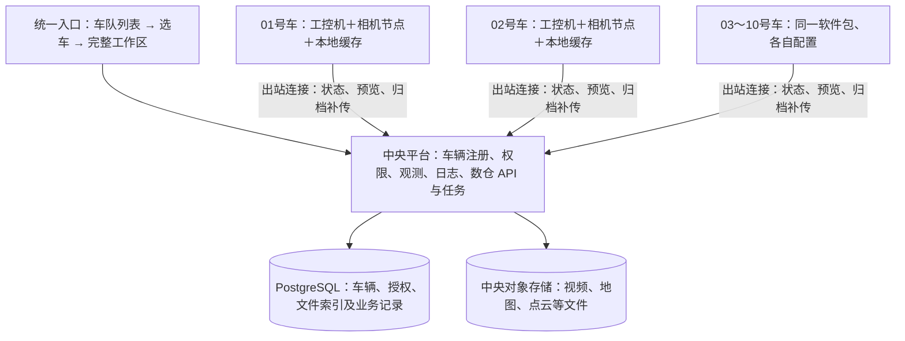

# 2～10 台机器人接入规划

> 2026-11-09 更新：本文件保留原始规划语境；当前已实现的机器人选择、采集/上传身份绑定及接入步骤见 [多机器人接入与代码迁移](multi-robot.md)。数仓现已部署到云端，下面关于“当前位于工控机”的描述属于历史状态。按车远程设备控制、自动签发/撤销全部 SSH 授权和双车实车验收仍未完成。

规划日期：2026-10-31。范围：同一团队先接入 2～10 台车，让每台车使用现有观测、设备启停、现场调试、导航、采集、数仓与运维能力。本文件是实施方案，尚未改造运行服务或迁移数据。

建议采用一个中央平台，每台车运行独立的设备服务，共用软件版本，使用各自的车辆配置和凭证。新车接入后进入同一套完整工作区；硬件能力由实际配置和收到的数据决定。

**一、目标结构**



中央数仓 API、worker、PostgreSQL、Redis 和正式对象存储应部署到独立服务器或云服务。当前数仓位于现车工控机，并通过专用隧道提供公网访问；要先解除这一依赖。任意车辆关机后，其他车辆和历史数据仍应可用。

沿用现有 Python 观测后端与 NestJS 数仓 API/worker，增加车辆注册、车辆上下文和按车授权。服务容量通过两车实测及十车模拟负载决定。

**二、每台车应拥有的功能**

| 功能 | 多车后的安排 |
|---|---|
| 总览、工控机、底盘及传感器状态 | 每车独立在线状态、时间戳、指标和趋势；分别显示工控机、相机节点、传感器的连接情况 |
| USB 相机、深度彩色与测距、识别 | 相机按车辆和物理设备绑定；沿用完整画面、深度色阶和识别能力 |
| 雷达、点云、地图、代价地图、覆盖与盲区配置 | 每车独立订阅、标定、安装几何和当前地图版本；切车时清除旧车图层 |
| 故障日志、每日测试统计 | 记录、筛选、分类、导出和测试归属均包含车辆身份 |
| 一键开启与关闭 | 每车部署相同启动器；明确“相机”和“全部设备”操作范围；关闭时等待本车文件收尾并报告未完成状态 |
| 地库采集 | 每车独立开关、开关版本、源端确认、原生数据通路、本地缓存及上传状态 |
| 数仓数据集、文件下载、版本及任务 | 按车筛选来源；自动归档属于单车；手工整理的数据集可按权限汇集多车样本 |
| 现场底盘调试、导航、清扫及对接 | 每车独立部署现有能力，使用本车设备映射、标定、地图和控制归属 |
| 版本与运维 | 每车显示软件、配置、标定版本，支持按车检查、升级和回退 |

功能一致以硬件齐备、正确配置和验收通过为前提。没有安装某个传感器时明确显示“未配置”；已经配置但断流时显示“离线／过期／故障”。

当前最新归档策略是“仅相机”，包含普通相机、深度彩色、16 位深度及相机配套信息；雷达、点云等仍用于实时观测。多车配置应保存这一现状，其他素材录制作为显式传感器策略启用。当前启动器的启动／状态默认也是相机范围，完整设备的启动／状态检查需明确选择；当前单独 `--stop` 默认仍为全部设备安全关闭。未来按车操作时应显式显示车辆与操作范围。

公网观测继续使用现有只读能力。现场启停和底盘操作分别归属本车。若后续要求从公网执行设备管理，需另行实现按车鉴权、命令有效期、幂等回执和执行状态；行驶控制还需要明确操作者与失联处置，不能从观测 WebSocket 直接透传命令。

**三、统一车辆身份与配置**

以数仓现有 `Robot.id` UUID 为统一内部身份，现车保留已有 UUID。旧观测字符串 ID 作为兼容别名登记，显示编号如 `robot-001`、显示名称如“01号车”可以调整。IP、主机名和车辆名称均不承担永久身份职责。

| 层级 | 示例 | 归属规则 |
|---|---|---|
| 项目／场地 | 地库测试项目、B2 场地 | 决定组织、数据和场地权限 |
| 车辆 | Robot UUID、robot-001 | 永久身份；在观测和数仓之间统一传递 |
| 设备来源 | ipc、jetson | 每车一个主观测来源，可有多个相机或其他来源；各自凭证可单独撤销 |
| 传感器 | usbFront、berxelDepth | 属于指定车辆和来源，绑定真实设备序列号或稳定路径 |
| 运行会话与片段 | sessionId、segmentId | 用于去重、补传、断电恢复和追溯 |

车辆注册需区分真实物理车与人工上传的虚拟数据来源。现有 `Robot` 表也被用于 `warehouse-upload:*` 等来源，车队列表不能把所有来源直接展示为小车。设备注册、凭证签发与撤销流程需要实现，已有数据库模型并不表示这些接口已可用。

每车配置档案至少包括：

```yaml
# 目标配置示例，字段尚未实施；凭证内容通过独立安全文件或设备授权获得。
robotId: <现有或注册生成的Robot UUID>
displayCode: robot-002
displayName: 02号车
hardwareProfile: ipc-jetson-v1
softwareVersion: <发布版本>
configVersion: <配置版本>
sources:
  ipc: { role: primary }
  jetson: { role: cameras }
network:
  cloudOrigin: <统一平台地址>
  rosDomainId: <本车分配值>
  discoveryServer: <本车发现服务地址或关闭>
devices:
  chassisOwner: <ipc或jetson，依据实际接线确认>
  chassisSerial: <稳定设备路径>
  lidar: <型号、序列号、车内地址>
  cameras: <相机槽位到物理设备映射>
navigation:
  geometryVersion: <本车实测尺寸与安装几何>
  calibrationVersion: <本车相机和雷达标定版本>
  mapId: <场地地图ID>
  mapVersion: <地图版本>
archive:
  policy: garage-only
  sensorPolicy: cameras
  localCacheLimitBytes: <按本车硬盘配置>
  minFreeBytes: <磁盘保护预留>
  compressionPreset: <已验证的归档策略>
credentials:
  observationCredentialRef: <本车本来源凭证引用>
  uploadCredentialRef: <本车上传凭证引用>
```

所有车共用同一套版本化发布物，按 CPU 架构分发工控机和相机节点程序。每车分别确认串口拥有者、USB 映射、传感器内外参、车体尺寸和地图。共享场地地图通过地图版本关联复用，车辆标定配置单独保存。

**四、观测与网页的改造**

1. 新增车队列表，显示车辆名称、在线状态、当前场地、电量、主要异常和归档状态；选车后进入现有完整观测工作区。
2. URL 包含车辆 ID，例如 `/robots/{robotId}/overview` 和 `/robots/{robotId}/media/cameras`。数仓链接携带相同车辆上下文，车辆选择按标签页保存。
3. API 逐请求校验车辆权限。目标接口包括 `/api/v1/robots` 及 `/api/v1/robots/{robotId}/snapshot`、`visuals`、`ws`、`faults`、`tests`。响应、缓存键和请求取消逻辑都包含 `robotId`。
4. 切车时关闭旧 WebSocket、停止视频、取消未完成请求、释放 Blob 并清空图表和地图。旧请求的迟到响应按车辆 ID 与页面代次丢弃。不同标签页观看不同车辆时，播放锁也按车区分。
5. 所有媒体帧、ETag、预览 hub、图层和资源配额均按车辆隔离；同车同路视频复用一条上游，再分发给浏览器。车队总览使用轻量状态，进入车辆工作区后按需请求视频。
6. 视频私有通道使用按车隔离的目录，例如 `robots/{robotId}/{sourceId}/camera.sock`。通道地址由服务器注册信息决定，各车使用独立授权。
7. 账号授权以项目和车辆共同决定。首期可沿用观测与数仓各自登录方式，但需绑定同一用户身份和中央车辆授权；查看、下载、采集管理、设备管理、控制权限分别记录。

现有状态库有 `(robot_id, source_id)` 基础，可用于兼容迁移；必须先修复单车清理、媒体缓存和查询范围，再启用第二车。历史业务记录与车辆注册使用中央 PostgreSQL，新增业务表通过 Prisma 管理；实时缓存与限流复用现有 Redis。现有观测历史库需先备份、校验并明确迁移映射。

**五、采集和数仓的改造**

自动日归档以 `(projectId, robotId, scope, 北京日期)` 唯一绑定数据集，接口按这些字段幂等获取或创建，服务器验证设备身份与车辆归属。显示名称不承担唯一性或权限判断。人工数据集继续允许有意汇集多车数据。

界面目录建议：

```text
01号车/
  地库_2026-10-31/
    原相机前/
      原相机前_14:50-15:50/
        视频片段
02号车/
  地库_2026-10-31/
    原相机前/
      原相机前_14:50-15:50/
        视频片段
```

新对象键建议使用稳定身份：

```text
projects/{projectId}/robots/{robotId}/garage/{date}/{sensorId}/{segmentId}/video.mkv
```

旧文件保留已有 `objectKey` 并补齐车辆绑定，新对象采用新规则。已有冻结数据集版本和校验信息需要保持可访问。逻辑文件去重必须考虑车辆、权限范围和目标目录；即使底层复用相同内容，也应保留每车独立来源记录。

每车独立保存地库开关及其版本、源端确认版本、录制状态和上传状态。地库开关通过中央 API 同步；云端请求尚未被设备收到时显示“待设备确认”，断网设备沿用最后确认的本地设置。设备本地也应能查看并调整自己的地库设置，重连时按明确的版本和冲突规则同步。

原生数据先在采集设备本地落盘，按现行压缩策略封装，随后分片补传并核对校验值。只有服务器确认完整入仓且对象可访问后才释放本地中转副本。HTTP 202、上传进度 100% 或服务在线均不能单独作为已持久保存的依据。

中央对象存储初期可迁移现有 MinIO；结合当前硬盘压力，目标建议接 OSS。OSS 目前尚未接入，适配器、分片合并、权限下载、worker、DVC 和公网下载通道需要一起验证。OSS 的分片上传提供重传失败分片和断点续传基础，应用仍需持久化上传任务状态并完成最终校验。[官方分片上传文档](https://help.aliyun.com/zh/oss/user-guide/multipart-upload)

车辆启停只管理本车服务。关闭流程先停止受管数据源，再等待活动文件和视频封装收尾；未完成上传的文件保留并明确报告。中央数据服务持续运行。按顺序关闭与突然断电分别验收，短录制和异常恢复必须有真实文件与状态证据。

**六、车内通信和容量**

同车的工控机、Jetson 和相关 ROS 节点使用同一个域；不同车分配不同域和自己的发现服务，统一贯通 shell、systemd、设备启动器和现场工具。可先登记 10～19 作为候选域，安装时检查主机端口和参与者数量。ROS 官方说明同域节点可以互相发现并通信，建议不同计算机组使用不同域；域隔离仍需配合独立的应用授权。[ROS 2 Humble 官方文档源码](https://raw.githubusercontent.com/ros2/ros2_documentation/humble/source/Concepts/Intermediate/About-Domain-ID.rst)

每车独立车内网络可以复用内部地址段；接入同一二层网络时需要不同静态地址。云连接使用设备身份和出站连接，与热点分配到的公网出口地址解耦。

每车分别限制媒体码率、补传带宽、并发任务和缓存空间。断网缓存预算根据实际归档产出速率乘以目标断网时长估算，再预留封装过程临时空间、恢复余量和磁盘保护空间；16 位深度需要单独实测。达到保护线时明确告警和报告未保存范围。

云端同时设置每车及全平台的请求、视频、日志和任务预算。先做两车完整压力测试，再模拟十车；观察 CPU、内存、视频出口、对象存储请求、归档队列和补传完成时间后决定服务器规格。

**七、实施顺序和交付门槛**

| 阶段 | 交付内容 | 进入下一阶段的条件 |
|---|---|---|
| 1. 登记现车与配置化 | 固化功能基线；统一 Robot UUID；区分物理车；建立来源、能力、用户车辆授权；去除启动器中的固定域与固定车配置 | 现车完整回归；历史数据与旧链接仍可访问；配置缺失明确报错 |
| 2. 完成按车隔离与中央服务 | 改造观测、媒体、日志、测试、归档开关和数据集；迁出当前工控机上的共享数仓服务；备份、校验和回退 | 两台合成车同名相机、同日采集、相同内容并发上传均独立；模拟关掉现车后另一车仍可归档和下载 |
| 3. 接第二台实车 | 部署相同发布物，填写第二车配置，确认设备映射、标定和现场控制归属 | 两车同时通过下方功能与隔离验收 |
| 4. 扩到 3～10 台 | 标准化安装、注册、自检、版本管理及分批升级；按实测配置云资源和存储配额 | 模拟十车负载达标；升级失败可逐车回退；任一车异常不拖垮其他车 |

第一台车的 UUID、历史文件、冻结版本和可恢复归档原件应在迁移前备份。迁移先增加车辆映射，再切换新 API 和上传器；旧只读链接可暂时固定映射到现车。写操作必须明确车辆和授权。中央存储切换需校验已有对象和索引，未完成上传任务先收尾或带状态迁移，确认后再释放旧副本。

**八、两车验收清单**

- 两车同时上线，逐项检查上文功能表；硬件缺失和真实断流可区分。
- 两车使用相同的相机键和文件名、同一天和同一时段采集，画面、日志、测试、数据集和下载均归属正确。
- 切车及两个标签页同时看车时，旧帧、趋势、地图、视频播放锁和晚到请求均不串车。
- A 车进入地库并断网，本地按原策略采集；B 车实时观测和归档持续正常；A 恢复后补传且不重复入仓。
- 关闭 A 的地库开关、相机或全部设备，B 的对应状态及共享数仓不受影响；离线开关请求准确显示待确认。
- 秒级短录正常收尾；写盘或上传中关闭、进程异常、断电恢复及缓存保护均可追溯，未确认文件继续保留。
- A 的设备凭证不能提交 B 的观测、媒体、文件或采集设置；只授权 A 的账号不能查看、下载或导出 B 的数据。
- 单车重连、异常高频日志、慢浏览器或补传积压不抢占其他车辆的全部资源。
- 机器人停机后，历史视频、地图、日志、测试和冻结数据集版本仍可访问。

**当前代码证据与实施注意**

| 位置 | 已确认事项 |
|---|---|
| `cloud/backend/security.py` | 配置只允许一个 Robot ID、全局一个 primary，需改为每车注册与来源授权 |
| `cloud/backend/store.py` | source 有复合身份，但媒体按 camera key 保存；初始化清理未配置来源，不能直接用多个旧 Store 共用库 |
| `cloud/backend/app.py`、`fault_logs.py`、`test_stats.py` | 路由、WS、故障筛选与每日统计需贯通车辆范围；告警保留上限需逐车预算 |
| `cloud/backend/native_video.py`、`deploy/scripts/native_video_tunnel.sh` | 视频 hub 和 socket 需按车区分 |
| `cloud/frontend/video-lease.js` | 播放锁目前覆盖整个站点，需支持不同车辆的独立标签页 |
| `collector/archive_upload.py` | 日数据集按名称查找；第二车同日会触发 OWNERSHIP_CONFLICT，需改为按车的归档绑定 |
| `DBProg/.../apps/api/src/archive/archive.service.ts` | 只有一份地库开关和设备状态目录，需按车控制与确认 |
| `DBProg/.../apps/api/src/uploads/uploads.service.ts` | 去重范围和物理车／人工来源类型需调整 |
| `DBProg/.../apps/api/prisma/schema.prisma` | 已有 Robot、RobotFile.robotId、项目关系；Dataset.name 全局唯一，自动归档身份需要显式建模 |
| `deploy/scripts/start_all_devices.py`、`device_sources.py` 及 systemd 单元 | 当前启动器也管理本机数仓，且部分 ROS 域固定为 0；需拆分中央服务与车辆生命周期 |

上述是源码与现有文档审查结论。实车功能一致性、云资源容量和最大断网可持续时间，需要在实施阶段按清单测量验收。
